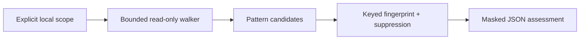

# Architecture and threat model

The user selects one authorized local root. A bounded, non-following directory walk reads regular files, applies limited patterns, validates card candidates with Luhn, and computes keyed HMAC-SHA256 fingerprints. Candidate strings stay in process memory and are never returned or persisted. Reports use relative paths, line numbers, file hashes, and permission mode observations. Suppressions match HMACs.

Threats include out-of-scope traversal, raw PII leakage, reversible unsalted fingerprints, excessive memory use, and false-positive classification. Controls include no symlink traversal, `O_NOFOLLOW` file opens where supported, byte/entry caps, HMAC with a required private key, and no raw previews. Remaining risks: file races under concurrent modification, paths containing PII, incomplete permission semantics, and regex false positives. Use a restricted host and review results before sharing.
